# Post-Q Wallet

A self-custodial, multi-chain crypto wallet with built-in **cross-chain swaps**. The layout follows Phantom's newer design, with gradient touches borrowed from Rainbow. It runs entirely in the browser: your keys are generated, encrypted and used on your device and never leave it.

| Cross-chain swap (Arbitrum ETH → Solana SOL) | Onboarding | Send | Portfolio & receive |
|:-:|:-:|:-:|:-:|
|  |  |  |  |

> The screenshots and GIFs were recorded in **demo mode**: balances and quotes are simulated, but key generation, vault encryption and every swap safety check run for real.

## Supported chains

| Family | Chains | Derivation path | Assets |
|---|---|---|---|
| EVM | Ethereum, Base, Arbitrum, Optimism, Polygon, BNB Chain, Avalanche | `m/44'/60'/0'/0/0` (MetaMask-compatible) | Native + USDC (+ USDT on Ethereum) |
| Solana | Solana mainnet | `m/44'/501'/0'/0'` (Phantom-compatible) | SOL + USDC |
| Bitcoin | Bitcoin mainnet | `m/84'/0'/0'/0/0` (native SegWit `bc1q…`) | BTC |

One 24-word recovery phrase controls all of them. You can import an existing Phantom, MetaMask or Rainbow phrase (12 or 24 words), and the same default addresses come up.

## Cross-chain swaps

Routing goes through the [LI.FI](https://li.fi) aggregator, which combines bridges and DEXs (Across, Mayan, Stargate, THORChain, Jupiter, Uniswap and more). That lets the wallet swap **any supported asset into any other across EVM, Solana and Bitcoin** in one flow:

1. Type an amount. The wallet fetches the best route (debounced, cancellable) and shows the rate, the route, the estimated time, all fees and the minimum you'll receive.
2. **Review swap** runs the safety checks listed below. Any failing check disables the button.
3. Press and hold to confirm. The wallet signs locally, broadcasts, then tracks the bridge until funds arrive on the destination chain.

<p>
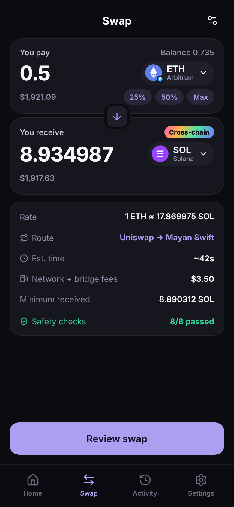 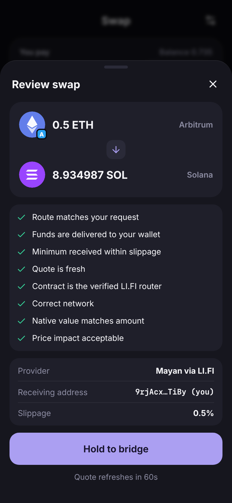 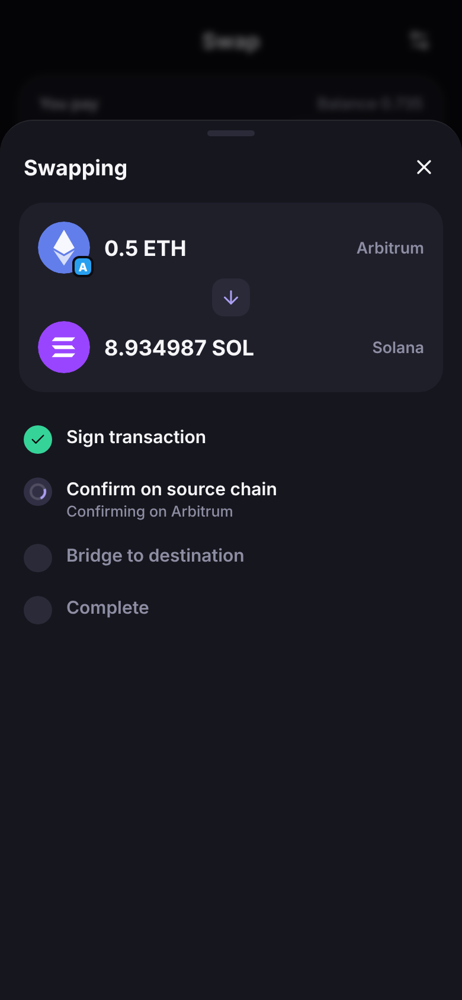 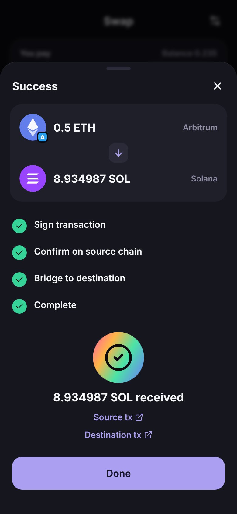
</p>

### Quote safety checks (`src/core/swap/validate.ts`)

The aggregator API counts as **untrusted input**. A quote can only be signed when all of these hold:

- The chains, tokens and amount in the quote match what you asked for.
- Both the sender and the recipient are **your own** addresses.
- The EVM transaction targets the verified LI.FI Diamond (`0x1231DEB6…4EaE`) on the correct chain id.
- An ERC-20 approval goes to that same verified contract and covers **the exact amount only**. The wallet never grants unlimited approvals.
- The guaranteed minimum output respects your slippage setting.
- The quote is less than 60 seconds old. The wallet re-checks at signing time.
- Price impact plus fees: above 5% you must acknowledge a warning, and above 15% the swap is blocked.
- Solana: the wallet only signs if it is the fee payer and the only required signer.
- Bitcoin PSBTs: every input must belong to this wallet, outgoing value can't exceed the quote, and the fee is bounded.

## Screens

<p>
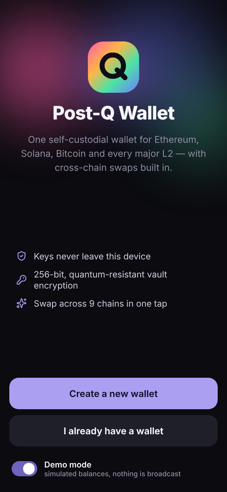 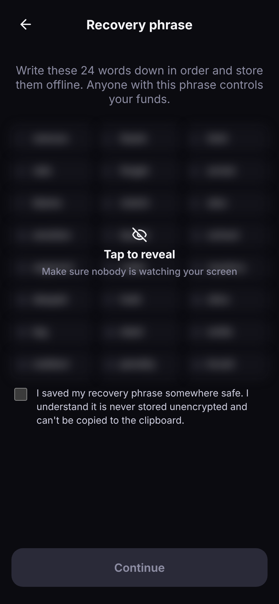 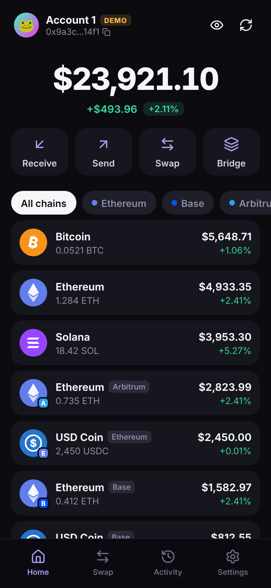 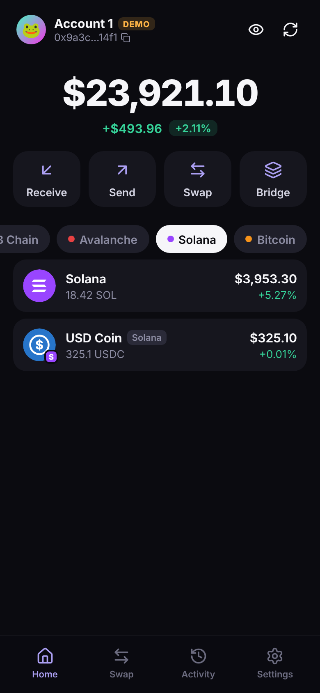 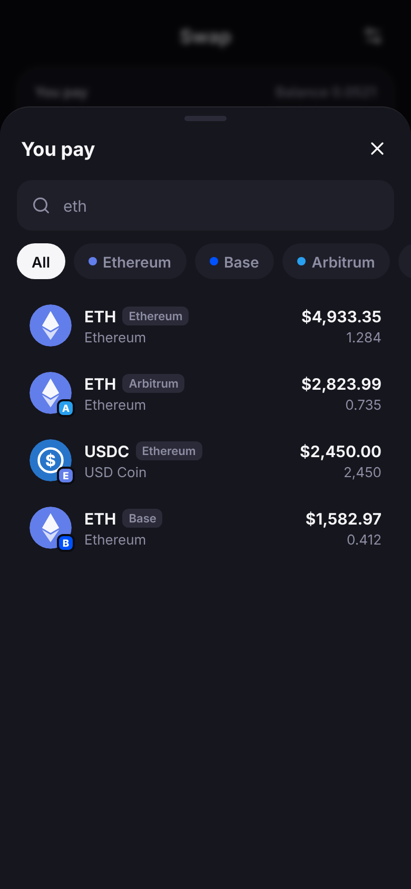
</p>
<p>
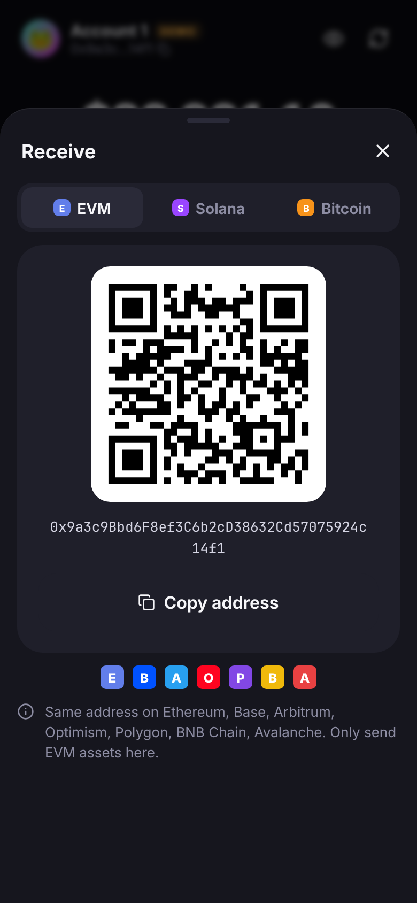 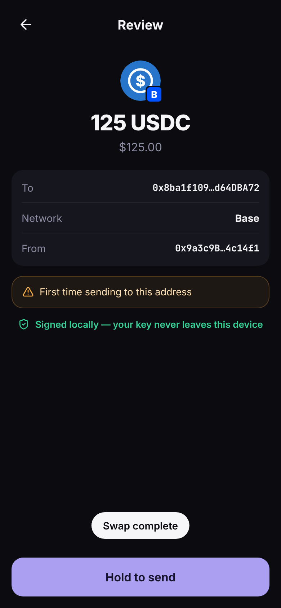 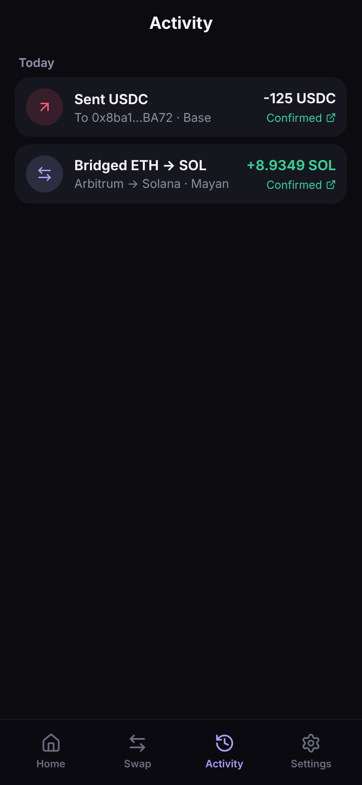 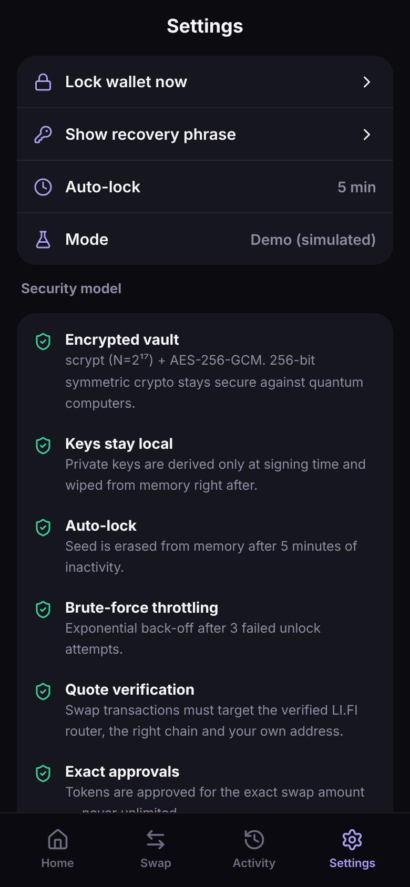 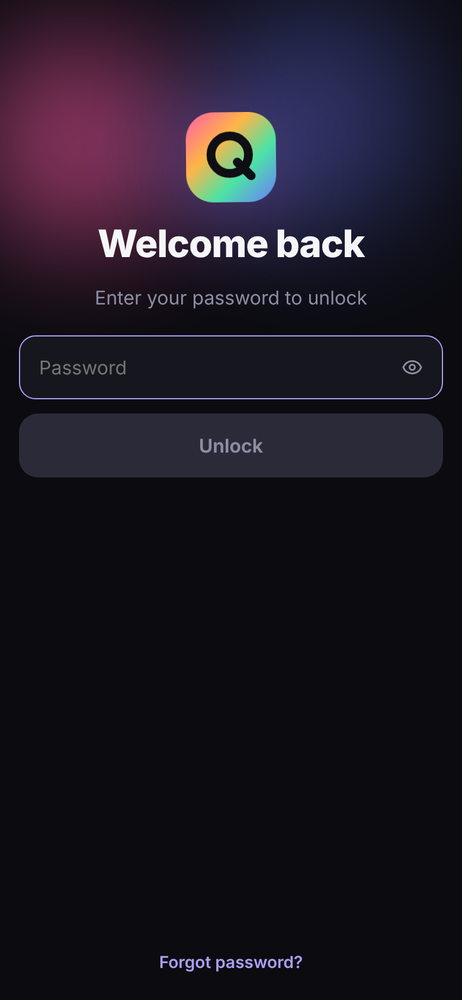
</p>

## Security model

| Area | What the wallet does |
|---|---|
| **Entropy** | 24-word BIP-39 phrase (256 bits) from `crypto.getRandomValues`. |
| **Vault at rest** | `scrypt(N=2¹⁷, r=8, p=1)` → AES-256-GCM with a random 32-byte salt and a 96-bit IV. Versioned associated data blocks blob-swapping. Planted vaults with downgraded KDF parameters are refused. |
| **Post-quantum** | The vault uses only symmetric primitives with 256-bit keys, which keep ≥128-bit security against Grover's algorithm. *On-chain signatures (ECDSA/EdDSA) are set by each blockchain and are not quantum-safe; no wallet can change that.* The Bitcoin wallet uses P2WPKH, which keeps the public key hidden until the first spend. |
| **Keys in memory** | The seed lives only in a module closure (not React state, storage or logs). Private keys are derived per signature inside `withPrivateKey()` and zeroed right after. Auto-lock after 5 minutes idle wipes the seed. |
| **Unlocking** | Three free attempts, then exponential back-off capped at 15 minutes. |
| **Recovery phrase UX** | Blurred until you tap to reveal. You must pass a 3-word confirmation quiz. Copying it is deliberately impossible, because other apps can read the clipboard. Showing it again requires your password. |
| **Transactions** | Every transaction is signed locally. Value-moving actions need a press-and-hold. Addresses are validated (EIP-55 checksum, base58 + curve check, bech32). The send screen warns about address-poisoning look-alikes, self-sends and first-time recipients. |
| **Supply chain** | Crypto comes only from audited `@noble/*` and `@scure/*` libraries plus `viem`. Solana is implemented directly on those libraries rather than `@solana/web3.js`, which had a malicious release in Dec 2024. Dependency versions are pinned exactly and `ignore-scripts=true` is set in `.npmrc`. `npm audit` reports 0 vulnerabilities. |
| **Browser hardening** | Production builds carry a strict CSP: `default-src 'none'`, `script-src 'self'`, and `connect-src` limited to the RPCs, LI.FI and the price feed. There are no third-party scripts, analytics or remote images, and the font is self-hosted. The app refuses to run inside frames. `public/_headers` sets `frame-ancestors 'none'`, HSTS, nosniff and a restrictive Permissions-Policy. |

### Known limitations

- **Unaudited software.** Have it independently audited before you trust it with significant funds.
- The vault sits in `localStorage`. Malware or a malicious browser extension on the same machine with access to this origin could capture your password as you type it. A browser-extension or native build would add OS-level isolation.
- Live mode depends on public RPC endpoints (PublicNode, mempool.space) and the LI.FI API. You can point the wallet at your own nodes with the `VITE_RPC_*` and `VITE_BTC_API` environment variables, and the CSP picks them up automatically.
- Bitcoin-origin swaps depend on LI.FI's UTXO transaction format and should be treated as **experimental**.
- The token list is a curated allow-list, so unknown or airdropped spam tokens are never displayed.

## Development

```bash
npm ci
npm run dev        # http://localhost:5173 (CSP is only injected in production builds)
npm test           # 36 unit tests: derivation vectors, vault, Solana encoding, swap validation, BTC tx building
npm run build      # type-check + production build into dist/
npm run media      # rebuild screenshots + GIFs in docs/media (needs ffmpeg + Chromium)
```

To try the wallet without funds, switch on **Demo mode** on the welcome screen, or open `/?demo` before you create a wallet.

### Test coverage highlights

- EVM, Solana and Bitcoin addresses for the `abandon … about` test phrase match MetaMask, Phantom and the BIP-84 spec vector.
- SLIP-10 ed25519 official test vectors.
- Solana SOL and SPL transfer messages are **byte-identical** to `@solana/web3.js` output, and associated token addresses match `@solana/spl-token`.
- Vault round-trip, wrong password, ciphertext tampering, KDF downgrade and lockout back-off.
- Swap validation: unknown router, foreign recipient, chain-id or amount tampering, unknown approval spender, slippage floor, quote expiry and price impact.

### Layout

```
src/core/            framework-free wallet logic
  keyring.ts         BIP-39/32/44/84 + SLIP-10 derivation, key wiping
  vault.ts           scrypt + AES-GCM vault, lockout
  session.ts         in-memory unlocked session + auto-lock
  security.ts        address/password validation, poisoning detection
  chains/            registry, EVM (viem), Solana (hand-rolled), Bitcoin (btc-signer)
  swap/              LI.FI client, quote types, safety validation
  backend/           live (mainnet) and demo (simulated) backends
src/ui/              React screens and components
scripts/capture-media.mjs   Playwright script that produced docs/media
```

## License

MIT
