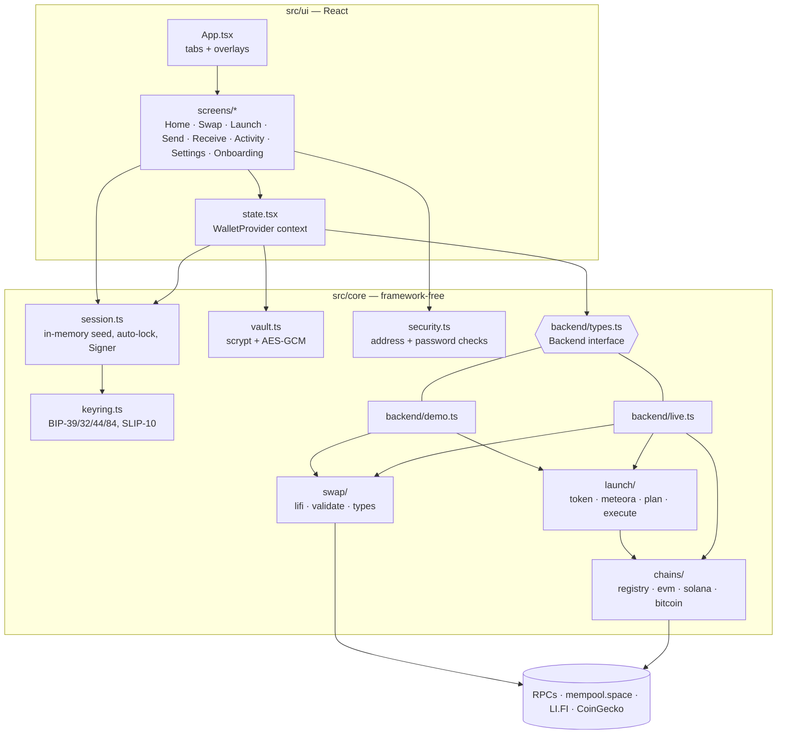
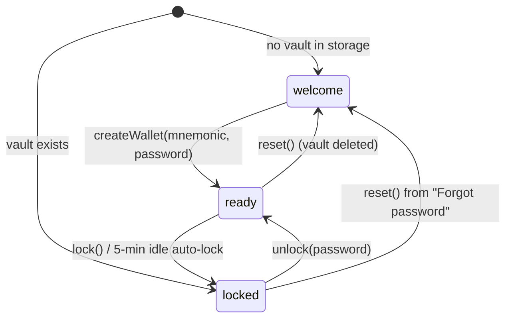
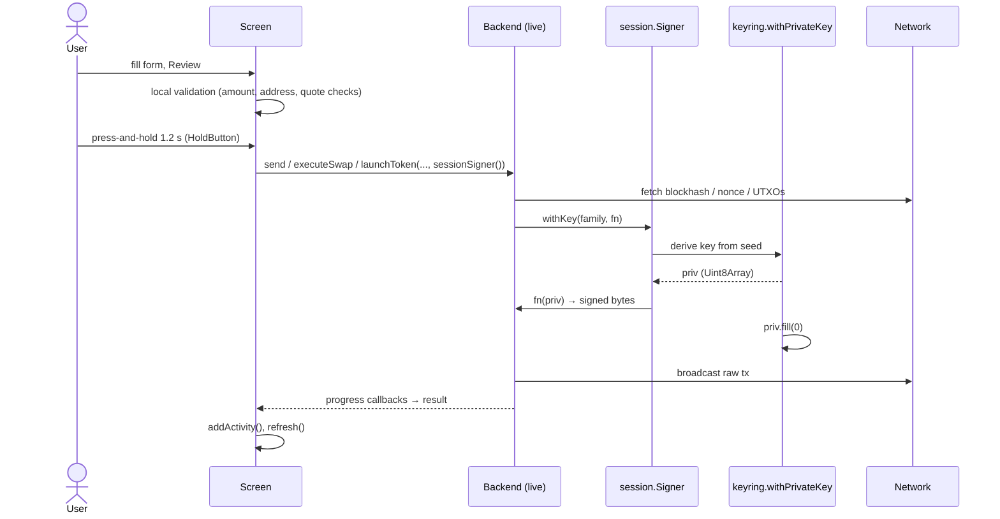

# Architecture

## Goals that shaped the design

1. **Keys never leave the device, and are in memory for as short a time as possible.** This drives the session module and the `withKey` signer API.
2. **Treat every network response as untrusted.** RPCs, the price feed and LI.FI can lie, so anything that becomes a signature is checked against local state first.
3. **Small, auditable dependency surface.** The cryptography uses only `@noble/*` and `@scure/*`. EVM uses `viem`. Solana and Meteora encoding are hand-written and verified against the official SDKs in tests, rather than shipped as dependencies.
4. **The UI is testable without money.** One `Backend` interface has two implementations, live and demo.

## Layers



`src/core` never imports React. Everything with security consequences lives there, and that is what the unit tests (`tests/`) exercise. `src/ui` is presentation plus orchestration: it collects input, calls core functions, and renders progress.

## Module map

| Path | Responsibility |
|---|---|
| `src/core/keyring.ts` | Mnemonic generation and validation; seed → EVM, Solana and Bitcoin keys; `withPrivateKey` (derive, use, wipe) |
| `src/core/vault.ts` | Vault encryption and decryption, blob validation, persistence, unlock throttling |
| `src/core/session.ts` | Holds the seed while unlocked; auto-lock timer; produces the `Signer` |
| `src/core/security.ts` | Password strength, per-family address validation, address-poisoning look-alike detection |
| `src/core/format.ts` | Strict decimal parsing, display formatting, `maxSendable` gas reserve |
| `src/core/chains/registry.ts` | Static list of chains and the allow-listed tokens; LI.FI chain ids and native-token addresses |
| `src/core/chains/evm.ts` | viem clients, balances, raw-transaction signing, ERC-20 transfer, approve and allowance |
| `src/core/chains/solana.ts` | Compact-u16, PDAs, associated token accounts, legacy message compiler, single- and multi-signer signing, RPC, simulate, confirm |
| `src/core/chains/bitcoin.ts` | Esplora API, UTXO selection, P2WPKH signing, OP_RETURN, broadcast |
| `src/core/swap/lifi.ts` | LI.FI `/quote` and `/status` clients; maps the response into `SwapQuote` |
| `src/core/swap/validate.ts` | Quote safety checks, the gate in front of every swap signature |
| `src/core/launch/token.ts` | SPL Token, System, Compute Budget and Metaplex instruction encoders; token-creation transaction |
| `src/core/launch/meteora.ts` | Meteora DAMM v2 PDAs, fee-scheduler encoding, liquidity math, pool and lock instructions |
| `src/core/launch/plan.ts` | Launch validation, presets, fair-launch checklist, transaction builders |
| `src/core/launch/execute.ts` | Live launch: sign, size-check, simulate, send, confirm, resume |
| `src/core/backend/*` | The `Backend` interface and its live and demo implementations |
| `src/ui/state.tsx` | `WalletProvider`: lifecycle phase, accounts, balances, prices, activity, launches, toasts |
| `src/ui/App.tsx` | Tab bar (Home, Swap, Launch, Activity, Settings) and overlays (Send, Receive, Bridge) |

## The Backend interface

```ts
interface Backend {
  kind: 'live' | 'demo';
  balances(accounts): Promise<Holding[]>;
  prices(): Promise<Prices>;
  quote(req, signal?): Promise<SwapQuote>;
  executeSwap(quote, signer, onProgress): Promise<SwapProgress>;
  send(token, to, amount, signer): Promise<string>;               // returns tx hash
  launchToken(plan, signer, onProgress, onRecord, resume?): Promise<LaunchRecord>;
}
```

`WalletProvider` builds one backend with `useMemo(() => demo ? createDemoBackend() : createLiveBackend(), [demo])`. Screens only call through this interface, so they don't know which implementation is active.

**What demo mode keeps real.** Key generation, vault encryption and decryption, the session, address validation, the swap safety validator (demo quotes are built to pass it), and launch planning, including the real pool math.

**What demo mode replaces.** Balances and prices are fixed tables. Quotes are computed from those prices. Execution only sleeps and returns fake hashes. Nothing is broadcast.

## Lifecycle and state



`WalletProvider` (`src/ui/state.tsx`) holds the following:

| State | Source | Persisted? |
|---|---|---|
| `phase` | presence of the vault + session events | derived |
| `accounts` (public addresses only) | `openSession()` | no |
| `holdings`, `prices` | `backend.balances()` / `backend.prices()` | no |
| `activity` | appended after sends, swaps and launches | `localStorage['pqw.activity']` (public data only) |
| `launches` | `saveLaunch()` from the launcher | `localStorage['pqw.launches']` |
| `demo` | onboarding toggle / `?demo` | `localStorage['pqw.mode']` |

**The seed is never in React state.** It lives in `session.ts` and is reachable only through `sessionSigner().withKey(...)`. That keeps it out of React DevTools, re-render snapshots and any accidental serialisation.

Global `pointerdown` and `keydown` listeners call `touchSession()`, which restarts the 5-minute auto-lock timer on any interaction.

## From tap to signature: the common path



Two properties hold on every path:

- **Hold-to-confirm.** `HoldButton` (`src/ui/components/common.tsx`) only calls `onConfirm` after 1.2 s of continuous pointer or keyboard press. A single click, an accidental tap or a clickjacked click does nothing.
- **Keys exist only inside `fn`.** `withPrivateKey` wraps `fn` in `try/finally` and zeroes the key buffer whatever the outcome.

## UI composition

- `App.tsx` renders exactly one of: onboarding, unlock, or the tabbed shell. Overlays (Send, Receive, Bridge) are absolutely positioned screens on top of the shell.
- Bottom sheets (`Sheet`) are used for review steps and pickers. Escape or a backdrop click closes them, except while a swap or launch is in flight.
- The visual design is a phone-sized column (max 430 px) that becomes a framed device on large screens. All icons are local SVG (`components/icons.tsx`) and the font is self-hosted, so the CSP needs no remote images or fonts.

## Error-handling philosophy

- **Validation errors** (bad address, too-precise amount, invalid ticker) are shown inline and disable the primary button. They are never thrown.
- **Safety-check failures** (swap validator, launch plan errors) disable confirmation and say why. Some are warnings that need an explicit checkbox; others are blockers.
- **Network or execution errors** become a failure state in the relevant flow. Partially completed work is recorded, for example a launch's `token-created` record, so it can be resumed rather than lost.
