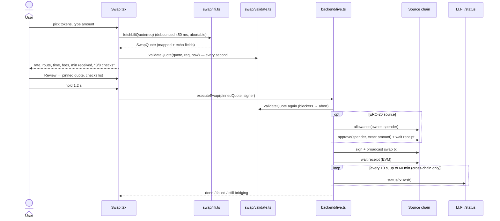

# Cross-chain swaps

Swaps and bridges go through the [LI.FI](https://li.fi) aggregation API. It searches bridges (Across, Mayan, Stargate, THORChain, …) and DEXs (Uniswap, Jupiter, …) for the best route between any two supported assets and returns a ready-to-sign transaction. The wallet treats that transaction as **untrusted input**. It is validated against the user's request before it can be signed, and validated again at signing time.

## 1. Requesting a quote (`src/core/swap/lifi.ts`)

`GET https://li.quest/v1/quote` with:

| Param | Value |
|---|---|
| `fromChain`, `toChain` | LI.FI chain ids from the registry (EVM chain id, `1151111081099710` for Solana, `20000000000001` for Bitcoin) |
| `fromToken`, `toToken` | `lifiTokenAddress(token)`: the contract or mint, or LI.FI's native sentinel |
| `fromAmount` | raw units as a decimal string |
| `fromAddress`, `toAddress` | **the wallet's own** address on the source and destination families |
| `slippage` | 0.003, 0.005 (default), 0.01 or 0.03 |
| `integrator` | `post-q-wallet` |
| `order` | `RECOMMENDED` |

The response is mapped into a `SwapQuote` (`src/core/swap/types.ts`):

- **Economic fields**: `toAmount`, `toAmountMin`, fee and gas USD (summed from `feeCosts` and `gasCosts`), `fromUsd` and `toUsd`, `durationSec`, route names, `approvalAddress`.
- **`tx`**: a tagged union, depending on the source family:
  - `evm` → `{ chainId, to, data, value, gasLimit? }`
  - `solana` → `{ base64 }`, a serialized transaction
  - `bitcoin` → `{ psbtHex }` if `data` starts with the PSBT magic `70736274ff`, otherwise `{ to, value, memo }` (vault deposit + OP_RETURN memo)
- **`echo`**: LI.FI's own `action` fields (chain ids, token addresses, amount, from and to addresses), kept verbatim so the validator can compare them with what the user asked for.
- **`fetchedAt`**: a local timestamp, used for expiry.

Quotes are fetched with a 450 ms debounce after the last keystroke. Each new request aborts the previous one through `AbortController`, so a slow old response can't overwrite a newer one.

## 2. The safety validator (`src/core/swap/validate.ts`)

`validateQuote(quote, request, now)` returns a list of `SafetyCheck { label, ok, level: 'ok' | 'warn' | 'block', detail }`. Any `block` disables the Review button and the hold-to-swap button. A `warn` needs the user to tick "I understand the warnings above".

| Check | Rule | On failure |
|---|---|---|
| Route matches your request | `echo.fromChainId`/`toChainId` equal the registry LI.FI ids; `echo.fromToken`/`toToken` equal `lifiTokenAddress()` of the chosen tokens (case-insensitive); `echo.fromAmount` equals the requested raw amount exactly | block |
| Funds are delivered to your wallet | `echo.toAddress` and `echo.fromAddress` equal the wallet's own addresses | block |
| Minimum received within slippage | `toAmountMin ≥ toAmount × (1 − slippage − 0.1%)` and `toAmountMin ≤ toAmount` | block |
| Quote is fresh | `now − fetchedAt < 60 s` | block |
| Contract is the verified LI.FI router *(EVM)* | `tx.to` is the LI.FI Diamond `0x1231DEB6f5749EF6cE6943a275A1D3E7486F4EaE` | block |
| Correct network *(EVM)* | `tx.chainId` equals the source chain's EVM id | block |
| Exact-amount approval only *(EVM, ERC-20 source)* | `approvalAddress` is absent or is the Diamond | block |
| Native value matches amount *(EVM)* | `tx.value − (native ? fromAmount : 0) ≥ 0` | block |
| Bridge messaging fee *(EVM, only if extra value > 0)* | Some bridges charge extra native value for cross-chain messaging. For a native-asset source it must be under 3% of the amount; otherwise the extra is just shown. | warn |
| Transaction payload present *(Solana / Bitcoin)* | non-empty tx; for memo-style Bitcoin, `value == fromAmount` | block |
| Price impact acceptable | `1 − toUsd / fromUsd` under 5% is ok, 5–15% warns, 15% or more blocks | warn / block |

The swap screen re-runs the validator every second (`now` ticks). When the visible quote expires and the user isn't reviewing, a new quote is fetched automatically. In the review sheet, an expired quote swaps the hold button for "Quote expired — refresh".

### The pinned quote

When the user opens Review, the quote is copied into a separate `active` state, and everything from then on uses that object: the checks list, the hold button and `executeSwap`. Later quote refreshes, or balance changes from a refresh after the swap, can't replace the quote the user is looking at. Before this fix, the success screen could disappear when balances refreshed.

### What the validator cannot see

These limits are listed honestly so reviewers can weigh them:

- **EVM calldata isn't decoded.** The validator trusts that the verified LI.FI Diamond contract executes the route its `echo` fields describe. The protection is that the call can only go to that one audited contract, with the exact value, approving the exact amount. A compromised LI.FI *API* could still return calldata for the right contract that encodes a different recipient. The Diamond's on-chain logic is what enforces the route.
- **Solana transactions are checked structurally** (fee payer = us, sole signer), not instruction by instruction.
- **Bitcoin memo routes** send to the vault address LI.FI provides. The memo tells THORChain where to deliver. Treat Bitcoin-origin swaps as experimental.

Future hardening could decode LI.FI calldata (`BridgeData.receiver`) and Solana instructions, and simulate EVM transactions before signing.

## 3. Execution (`createLiveBackend().executeSwap`)

1. **Re-validate** with a request rebuilt from the pinned quote. Any blocker throws `Quote failed safety checks — refresh and try again`.
2. **EVM source:**
   1. If the source is ERC-20 and `approvalAddress` is set, read `allowance(owner, approvalAddress)`. If it is below `fromAmount`, send `approve(approvalAddress, fromAmount)` (phase `approving`) and wait for the receipt.
   2. Sign and send `{ to, data, value, gas: gasLimit }` (phase `signing`), then wait for the receipt (phase `submitted`). If the transaction reverts, return `failed`.
3. **Solana source:** base64-decode, `signSerializedTransaction` (fee payer and signer checks above), then `sendTransaction`.
4. **Bitcoin source:**
   - **PSBT**: every input's `witnessUtxo.script` must be this wallet's P2WPKH script. The total sent to non-wallet outputs must be no more than `fromAmount`. The fee must be between 0 and 100,000 sats. Then sign, finalise and broadcast.
   - **Memo**: build a fresh transaction: output 1 is `to` ← `value`, output 2 is `OP_RETURN memo` (hex-decoded if the memo is hex, otherwise UTF-8). Change returns to the wallet. Sign and broadcast.
5. **Same chain:** done.
6. **Cross-chain:** phase `bridging`. Poll `GET /v1/status?txHash&fromChain&toChain` every 10 s for up to 60 minutes:
   - `DONE` returns `done`, with the destination tx hash when available. Substatus `PARTIAL` or `REFUNDED` is reported as such.
   - `FAILED` returns `failed` ("funds are usually refunded on the source chain").
   - On timeout the result stays `bridging` ("check Activity later").

The UI shows a stepper: Approve token (only for ERC-20 on EVM), Sign, Confirm on source chain, Bridge (cross-chain only), Complete. Finished swaps are added to Activity with an explorer link. The live backend doesn't yet poll Solana or Bitcoin source transactions for confirmation before it starts polling bridge status.

## 4. Demo quotes

`createDemoBackend().quote` prices routes from a fixed price table with a realistic fee model:

- **Fees:** 0.25% for same-chain swaps; for cross-chain, 0.18% with a $0.35 minimum.
- **Gas:** $3.85 on Ethereum mainnet, $0.04 on L2s, $0.002 on Solana, $2.10 on Bitcoin.
- **Routes:** named per family pair, for example EVM to Solana goes through Uniswap → Mayan Swift (about 42 s), and Bitcoin through THORChain.

The `tx` targets the real LI.FI Diamond, and the `echo` fields mirror the request. That means **demo quotes go through the real validator**, and a test asserts that they pass every check.
