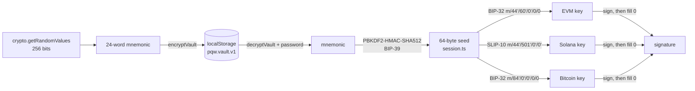

# Keys, vault and sessions

This document follows the recovery phrase from the moment it is generated to the moment a private key signs a transaction.



## 1. Generating the recovery phrase

`newMnemonic()` in `src/core/keyring.ts` calls `@scure/bip39`'s `generateMnemonic(wordlist, 256)`, which draws its entropy from `crypto.getRandomValues`. The wallet defaults to **24 words (256 bits)**. A quantum attacker running Grover's search would have to search 2^256 possibilities, which still leaves 128-bit security. Importing 12-word phrases is supported.

During onboarding the phrase is:

- **blurred until tapped** ("make sure nobody is watching");
- **never copyable**: there is no copy button and the text sits in plain `div`s;
- **confirmed by a quiz**: three positions are picked with `crypto.getRandomValues`, each with two decoy words drawn from the phrase's own distinct words. If a word appears twice in the phrase, it can't be used as a decoy against itself.

Imported phrases are normalised first (trimmed, lower-cased, whitespace collapsed by `normalizeMnemonic`), and the BIP-39 checksum must pass before the import button is enabled.

## 2. The vault format

`encryptVault(secret, password)` in `src/core/vault.ts`:

| Step | Detail |
|---|---|
| Password normalisation | `password.normalize('NFKC')` → UTF-8. Visually identical Unicode passwords therefore produce the same key. |
| Salt | 32 random bytes |
| KDF | `scrypt(N = 2^17, r = 8, p = 1, dkLen = 32)` using `@noble/hashes`' async implementation, so the UI thread isn't blocked. Takes about 128 MiB of memory and 1–2 s in a browser. |
| Key handling | The 32-byte key is imported into WebCrypto as a **non-extractable** `AES-GCM` key, then the raw bytes and the password buffer are zero-filled. |
| Cipher | AES-256-GCM, 96-bit random IV, 128-bit tag |
| Associated data | `"post-q-wallet/vault/v1"`. This binds the ciphertext to this format version, so a blob made for another context won't authenticate. |

The stored JSON (`localStorage['pqw.vault.v1']`) looks like this:

```json
{
  "v": 1,
  "kdf": { "name": "scrypt", "N": 131072, "r": 8, "p": 1, "salt": "<base64 32 bytes>" },
  "cipher": { "name": "AES-256-GCM", "iv": "<base64 12 bytes>" },
  "ct": "<base64 ciphertext || tag>"
}
```

### Why scrypt + AES-GCM (and "post-quantum")

- scrypt is memory-hard, so offline guessing on GPUs or ASICs is expensive. With N = 2^17 every password guess costs about 128 MiB × 2^17 sequential operations.
- Both primitives are symmetric. The best known quantum attack on them is Grover's algorithm, which only halves the effective key length. A 256-bit AES key still gives about 128-bit security, so the vault at rest is quantum-resistant.
- This **does not** make on-chain accounts quantum-safe. ECDSA (EVM, Bitcoin) and Ed25519 (Solana) are chosen by each blockchain, and a large quantum computer could break them from a known public key. Bitcoin P2WPKH addresses reveal the public key only when you first spend from them, which helps as long as addresses aren't reused.

### Decrypting and validating

`decryptVault(blob, password)` first runs `isBlob()`. It **rejects any blob whose KDF parameters are weaker than N = 2^14, r = 8, p = 1**. Without this check, an attacker with brief write access to storage could swap in a weak-KDF vault encrypted under a password they choose. You might then type your real password into a fake vault, or the attacker's cheap vault would make later guessing easy. Any AES-GCM failure, whether from a wrong password or tampered bytes, is reported as `WrongPasswordError`, so the error message reveals nothing about which one happened.

## 3. Brute-force throttling

Failed unlocks are counted in `localStorage['pqw.lockout'] = { fails, until }`:

| Failures | Delay before the next attempt |
|---|---|
| 1–3 | none |
| 4 | 2 s |
| 5 | 4 s |
| n | 2^(n−3) s |
| ≥ 13 | capped at 15 min |

A successful unlock clears the counter. Someone with direct access to the browser profile could delete this counter, so its job is to slow down guessing *through the UI*, for example by a person with brief physical access. The scrypt cost is what protects the vault against offline guessing.

## 4. Sessions: holding the seed

`src/core/session.ts` owns the only copy of the decrypted seed:

```ts
let seed: Uint8Array | null = null;     // 64-byte BIP-39 seed
let accounts: Accounts | null = null;   // public addresses only
```

- `openSession(mnemonic, onLock)` validates the mnemonic, computes the seed with `mnemonicToSeedSync`, derives the three public addresses, and starts the idle timer. The mnemonic string is not kept.
- `touchSession()` resets a 5-minute `setTimeout`. `WalletProvider` calls it on every `pointerdown` and `keydown`, and every `withKey` call refreshes it too.
- `closeSession()` calls `seed.fill(0)`, drops all references, clears the timer and notifies the UI, which returns to the unlock screen.
- `sessionSigner()` returns a `Signer`:

  ```ts
  { accounts, withKey(family, fn) → withPrivateKey(seed, family, fn) }
  ```

  This is the only way the rest of the app can reach key material. Backends receive a `Signer` and never see the seed.

**Limits of memory wiping in JavaScript.** `fill(0)` reliably clears the `Uint8Array`s this code owns. But JavaScript strings (the mnemonic during onboarding and unlock, and the password in input fields) are immutable and garbage-collected, and libraries may make internal copies. Wiping shortens how long secrets sit in memory; it can't guarantee their absence. That is one reason the design keeps the seed resident only while the wallet is unlocked and locks automatically.

## 5. Deriving keys per chain

| Family | Standard | Path | Curve | Address |
|---|---|---|---|---|
| EVM (all 7 chains) | BIP-44 | `m/44'/60'/0'/0/0` | secp256k1 | `keccak256(pubkey)[12:]`, EIP-55 checksum (viem `privateKeyToAddress`) |
| Solana | SLIP-10 | `m/44'/501'/0'/0'` | Ed25519 | base58(public key) |
| Bitcoin | BIP-84 | `m/84'/0'/0'/0/0` | secp256k1 | P2WPKH `bc1q…` (`@scure/btc-signer`) |

These are the default paths of MetaMask/Rainbow, Phantom/Solflare and most Bitcoin wallets, so the same phrase gives the same addresses there. `tests/keyring.test.ts` pins the well-known `abandon … about` vectors:

- EVM `0x9858EfFD232B4033E47d90003D41EC34EcaEda94`
- Solana `HAgk14JpMQLgt6rVgv7cBQFJWFto5Dqxi472uT3DKpqk`
- Bitcoin `bc1qcr8te4kr609gcawutmrza0j4xv80jy8z306fyu` (the BIP-84 spec vector)

### SLIP-10 for Ed25519

Ed25519 can't use BIP-32's additive derivation, so `slip10Ed25519(seed, path)` implements SLIP-10 directly:

```
I = HMAC-SHA512(key = "ed25519 seed", data = seed)
k, c = I[0:32], I[32:64]
for each index i (must be hardened, i ≥ 2^31):
    I = HMAC-SHA512(key = c, data = 0x00 || k || ser32(i))
    k, c = I[0:32], I[32:64]
return k
```

Every intermediate buffer is zero-filled after use. Non-hardened indices throw. The official SLIP-10 test vector 1 is part of the test suite.

### `withPrivateKey`

```ts
withPrivateKey(seed, family, fn, index = 0):
  priv = derive(seed, family, index)   // fresh copy
  try   { return await fn(priv) }
  finally { priv.fill(0) }
```

For secp256k1 the `HDKey` objects also have `wipePrivateData()` called on them. Keys are never cached between signatures. A test checks that the buffer handed to `fn` is all zeros once `fn` returns.

## 6. Resetting and multiple devices

- **Remove wallet** (Settings, or "Forgot password" on the unlock screen) requires typing `DELETE`. It removes the vault, the lockout counter, activity and launch history from this browser. Funds stay on-chain and can be restored with the recovery phrase.
- **Show recovery phrase** requires the password again (with the same throttling). The phrase is shown in a sheet with copying disabled and cleared from component state when the sheet closes.
- Vaults are per-browser and per-origin. There is no cloud sync, by design.
