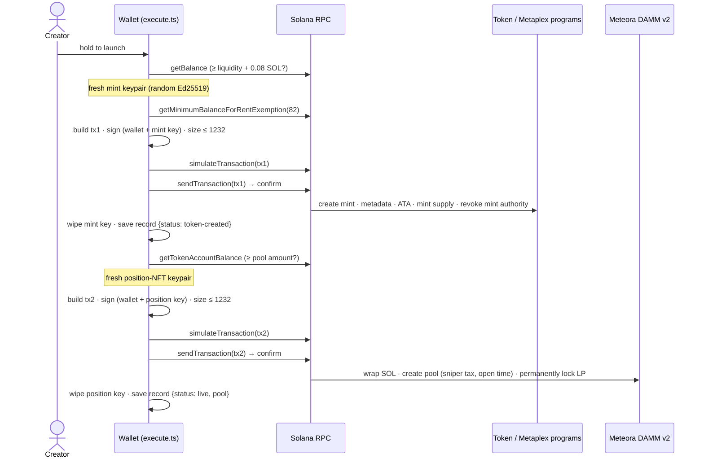

# Token launcher (Solana)

The **Launch** tab creates an SPL token and a liquidity pool designed so that neither bots nor insiders get an edge. This document covers the design rationale, the exact on-chain instructions, the anti-sniper fee math, the pool math, and what happens when something fails.

> **Status:** the instruction encoding is verified byte-for-byte against the official SDKs (see [Verification](#verification)), but the launcher has **not yet been run on mainnet**. Do one small launch first.

## The problem it solves

Most memecoin launches go wrong in one of four predictable ways:

| Attack | How it usually happens |
|---|---|
| **Sniping** | Bots watch for new pools and buy in the same block the pool is created, before any human can, then dump on later buyers. |
| **Insider allocation** | The creator, or wallets they control, keep a large share of supply outside the pool and sell into demand. |
| **Rug pull** | The creator withdraws the pool's liquidity, taking every buyer's SOL. |
| **Infinite mint / freeze** | The creator mints new supply or freezes holders' token accounts so they can't sell. |

The launcher blocks the last three outright and makes the first one economically pointless.

## What a launch does

Two transactions, both built and signed on the device:



### Transaction 1 — create the token (`buildTokenTx`, `src/core/launch/token.ts`)

| # | Program | Instruction | Purpose |
|---|---|---|---|
| 1 | Compute Budget | `SetComputeUnitPrice(50 000 µlamports)` | Priority fee so the transaction lands during congestion |
| 2 | System | `CreateAccount(mint, rent, 82 bytes, owner = Token program)` | Allocates the mint account; the fresh mint keypair co-signs |
| 3 | SPL Token | `InitializeMint2(decimals = 6, mintAuthority = wallet, freezeAuthority = None)` | **No freeze authority, ever** |
| 4 | Metaplex Token Metadata | `CreateMetadataAccountV3(name, symbol, uri, isMutable = false)` | On-chain name, ticker and metadata link. **Immutable.** No creators, collection or uses; 0 royalty. |
| 5 | Associated Token | `CreateIdempotent(wallet, mint)` | The creator's token account |
| 6 | SPL Token | `MintTo(full supply)` | Mints the entire fixed supply once |
| 7 | SPL Token | `SetAuthority(MintTokens → None)` | **Revokes the mint authority.** The supply can never change. |

Steps 6 and 7 are in the same atomic transaction, so there is no moment where the supply exists and the mint authority is still live.

### Transaction 2 — create and lock the pool (`buildPoolTx`, `src/core/launch/plan.ts`)

| # | Program | Instruction | Purpose |
|---|---|---|---|
| 1 | Compute Budget | `SetComputeUnitPrice(50 000)` | Priority fee |
| 2 | Associated Token | `CreateIdempotent(wallet, WSOL)` | Wrapped-SOL account |
| 3 | System | `Transfer(wallet → WSOL ATA, poolB lamports)` | Funds exactly the SOL the pool will take |
| 4 | SPL Token | `SyncNative(WSOL ATA)` | Turns the lamports into a WSOL balance |
| 5 | Meteora DAMM v2 | `initialize_customizable_pool(...)` | Creates the pool with the sniper tax and opening time; the fresh position-NFT keypair co-signs |
| 6 | Meteora DAMM v2 | `permanent_lock_position(liquidity)` | **Locks 100% of the LP position permanently** |
| 7 | SPL Token | `CloseAccount(WSOL ATA → wallet)` | Unwraps any leftover WSOL and reclaims rent |

Steps 5 and 6 are atomic: the pool never exists with unlocked liquidity.

Both transactions are tested to fit Solana's 1232-byte packet limit, even with a 32-byte name, a 10-character ticker and a 200-byte URI.

## Anti-sniper protections in detail

### 1. Sniper tax (DAMM v2 fee time scheduler)

Meteora DAMM v2 supports a **base fee that decays over time**, starting from when trading opens. The launcher sets an *exponential* schedule from a high starting fee down to the long-term fee:

```
reduction = floor(10 000 × (1 − (endBps / startBps)^(1 / periods)))      // in bps of the current fee
period(t) = min(periods, floor(t / periodFrequency))                       // t = seconds since open
fee(t)    = startFee × (1 − reduction / 10 000)^period(t)
```

| Preset | Start | Duration | Periods (each 10 s) | `reduction` |
|---|---|---|---|---|
| Light | 50% | 2 min | 12 | 2781 |
| Standard (default) | 75% | 5 min | 30 | 1340 |
| Maximum | 90% | 10 min | 60 | 722 |

The long-term fee is the user's choice of 0.25%, 1% (default) or 2%. With the long-term fee at 1%:

| Seconds after open | 0 | 10 | 30 | 60 | 120 | 180 | 300 | 600 |
|---|---|---|---|---|---|---|---|---|
| **Light** | 50.0% | 36.1% | 18.8% | 7.1% | 1.0% | 1.0% | 1.0% | 1.0% |
| **Standard** | 75.0% | 65.0% | 48.7% | 31.6% | 13.3% | 5.6% | 1.0% | 1.0% |
| **Maximum** | 90.0% | 83.5% | 71.9% | 57.4% | 36.6% | 23.4% | 9.5% | 1.0% |

**Why it works.** A bot that buys 10 SOL worth in the first second under *Standard* pays 7.5 SOL as fees and receives tokens for only 2.5 SOL, at a price it has already moved. To profit it would need the price to roughly quadruple before it can exit, and the exit sale is taxed too. A normal buyer waiting a few minutes pays 1–6%. The pool's fees are collected in SOL (`collect_fee_mode = OnlyB`) and accrue to the LP position, which belongs to the creator.

The UI draws the decay curve from `sniperTaxAt()`, which uses the same formula. The 27-byte on-chain encoding (`encodeSniperTax`) is:

```
cliff_fee_numerator u64   = startBps × 10^9 / 10^4      (fee denominator is 10^9)
number_of_period   u16    = periods
period_frequency   u64    = floor(durationSec / periods)   (seconds, because activation type = timestamp)
reduction_factor   u64    = reduction (above)
base_fee_mode      u8     = 1 (FeeTimeSchedulerExponential)
```

Bounds: the end fee must be at least 0.01% (`MIN_FEE_BPS`), the start fee at most 99% (`MAX_FEE_BPS`, pool version 1 limits), and the start fee at least the end fee.

### 2. Scheduled open

`activation_type = 1` (timestamp) and `activation_point = now + delay`, where the delay is 0, 5, 15 or 60 minutes. Choosing 0 sends `None`, meaning trading opens immediately. Until the activation point, the program rejects swaps from everyone, including the creator. This gives two things:

- **Verification time.** Anyone can inspect the mint (no mint or freeze authority), the metadata (immutable) and the pool (LP locked) before they can buy.
- **No first-block race against the pool creation.** A bot can't land a swap in the same block as `initialize_customizable_pool`. The fee clock starts at activation, so the opening moment gets the full sniper tax.

The opening time is recalculated from "now + delay" at the moment you press hold, so time spent on the review screen doesn't shorten the delay. `planLaunch` rejects opening times less than 60 s or more than 7 days away.

### 3. No insider supply

By default **100% of the supply goes into the pool**. An optional creator allocation of 2%, 5% or 10% (the maximum) stays in the creator's wallet. It is shown as a **warning** in the checklist, because buyers can see it on-chain and so should the creator. Rounding means the pool takes a tiny bit less token dust than supplied; that dust also stays with the creator, typically under one millionth of the supply.

### 4. Permanent liquidity lock

`permanent_lock_position(liquidity)` moves the entire position into Meteora's permanently-locked bucket. Locked liquidity **can never be withdrawn by anyone**. The position NFT, held in a program-derived token account tied to the creator's wallet, still entitles the creator to claim the position's trading fees. The wallet doesn't have a "claim fees" button yet; see [Limitations](#limitations).

## Pool configuration

`initialize_customizable_pool` parameters (Anchor/Borsh, after the 8-byte discriminator `[20,161,241,24,189,221,180,2]`):

| Field | Type | Value |
|---|---|---|
| `pool_fees.base_fee.data` | `[u8; 27]` | sniper tax, above |
| `pool_fees.compounding_fee_bps` | u16 | 0 |
| `pool_fees.padding` | u8 | 0 |
| `pool_fees.dynamic_fee` | `Option<…>` | `None` |
| `sqrt_min_price` | u128 | `4295048016` (protocol minimum) |
| `sqrt_max_price` | u128 | `79226673521066979257578248091` (protocol maximum) |
| `has_alpha_vault` | bool | false |
| `liquidity` | u128 | from the pool math below |
| `sqrt_price` | u128 | initial √price, Q64.64 |
| `activation_type` | u8 | 1 (timestamp) |
| `collect_fee_mode` | u8 | 1 (fees in token B = SOL) |
| `activation_point` | `Option<u64>` | open time, or `None` |

Token A is the new mint, token B is WSOL (`So111…112`). Both use the classic SPL Token program.

### Accounts (21)

| # | Account | W | S | Derivation |
|---|---|---|---|---|
| 0 | creator | | | wallet |
| 1 | position_nft_mint | ✓ | ✓ | fresh keypair |
| 2 | position_nft_account | ✓ | | PDA `["position_nft_account", nftMint]` |
| 3 | payer | ✓ | ✓ | wallet |
| 4 | pool_authority | | | `HLnpSz9h2S4hiLQ43rnSD9XkcUThA7B8hQMKmDaiTLcC` |
| 5 | pool | ✓ | | PDA `["cpool", max(mintA, mintB), min(mintA, mintB)]` (byte-wise) |
| 6 | position | ✓ | | PDA `["position", nftMint]` |
| 7–8 | token_a_mint, token_b_mint | | | new mint, WSOL |
| 9–10 | token_a_vault, token_b_vault | ✓ | | PDA `["token_vault", mint, pool]` |
| 11–12 | payer_token_a, payer_token_b | ✓ | | the wallet's associated token accounts |
| 13–14 | token_a_program, token_b_program | | | SPL Token |
| 15 | token_2022_program | | | for the position NFT |
| 16 | system_program | | | |
| 17 | event_authority | | | PDA `["__event_authority"]` |
| 18 | program | | | `cpamdpZCGKUy5JxQXB4dcpGPiikHawvSWAd6mEn1sGG` |
| 19–20 | remaining: token badges | | | PDA `["token_badge", mint]` for A and B |

All PDAs are under the cp-amm program. `permanent_lock_position` (discriminator `[165,176,125,6,231,171,186,213]`, argument u128 liquidity) uses: pool (W), position (W), position_nft_account, owner (S), event_authority, program.

## Pool math (`src/core/launch/meteora.ts`)

The pool is a **full-range** concentrated-liquidity position, which behaves like a constant-product AMM. Prices are `sqrt(price) × 2^64` (Q64.64), where price = token B per token A in raw units. Let `pa` and `pb` be the minimum and maximum √price.

**Initial price.** For token amount `A` and lamports `B`:

```
s = isqrt( (B << 128) / A )        // exact integer square root, Newton's method + correction
```

**Liquidity.** Take the smaller of what each side can support:

```
L_A = A · s · pb / (pb − s)
L_B = (B << 128) / (s − pa)
L   = min(L_A, L_B)
```

**Amounts the program will pull,** rounded up as on-chain:

```
a = ceil( L · (pb − s) / (s · pb) )
b = ceil( L · (s − pa) / 2^128 )
```

Because `L` is floored, `a ≤ A` and `b ≤ B` always hold. `planLaunch` asserts this, and the wallet wraps exactly `b` lamports.

**Display values.** Starting price per whole token = `(B / 10^9) / (A / 10^6)`. Starting market cap = that price × total supply. With the defaults (1 billion tokens, 5 SOL) the starting market cap is 5 SOL.

The SDK computes `s` with a 20-significant-digit decimal library. The integer `isqrt` gives the same value to within 10⁻¹² relative error. **Given the same `s`, the wallet's liquidity equals the SDK's exactly.** Both are tested.

## Planning and validation (`planLaunch`)

`planLaunch(config, solBalance, now)` returns the computed amounts, a list of `errors` (any error disables Review), and the **fair-launch checklist** shown on the review screen.

| Input | Rule |
|---|---|
| Name | 1–32 UTF-8 bytes |
| Ticker | 1–10 of `A–Z a–z 0–9 $ _ -` (uppercased in the UI) |
| Metadata URI | empty, or `https://`, `ipfs://` or `ar://`, at most 200 bytes |
| Supply | 1,000 to 10 trillion whole tokens (keeps raw supply below u64 max at 6 decimals) |
| SOL liquidity | ≥ 0.1 SOL, and liquidity + 0.08 SOL ≤ balance |
| Creator allocation | integer, 0–10% |
| Sniper tax | valid fee range (see above) |
| Opening time | none, or 60 s to 7 days from now |

The 0.08 SOL figure covers rent for the mint, metadata, two token accounts, pool, position, position NFT and vaults, plus the Metaplex fee and network fees. It is a conservative upper estimate; unused SOL stays in the wallet.

Before the hold-to-launch button is enabled, the review sheet also requires the creator to acknowledge that the SOL is locked forever, memecoins are speculative, and launching a token may carry legal obligations.

## Execution, safety and recovery (`src/core/launch/execute.ts`)

`sendLaunchTx(signer, instructions, extraKey)` handles each transaction:

1. Compiles a legacy message with a fresh `finalized` blockhash.
2. Inside `withKey('solana')`, asserts that the derived key's public key equals the wallet address, then calls `signLegacyMessageMulti(msg, [walletKey, extraKey])`.
3. Rejects the transaction if it is larger than 1232 bytes.
4. **Simulates** it (`sigVerify: true`). A failing simulation throws with the program error, and **nothing is sent**.
5. Sends, then polls for confirmation (up to 75 s). A transaction error or timeout throws.

**Ephemeral keypairs.** The mint keypair and the position-NFT keypair come from `ed25519.utils.randomPrivateKey()`. Each is used for exactly one signature and wiped in a `finally` block. Losing them afterwards is harmless: the mint authority is revoked, and ownership of the position NFT sits in the wallet's account.

**Resuming.** After transaction 1 confirms, a `LaunchRecord { status: 'token-created', mint, config, … }` is saved to `localStorage['pqw.launches']` *before* transaction 2 is attempted. If transaction 2 fails (simulation error, network drop, timeout), the **Your launches** list shows **Finish launch**. That action:

- rebuilds the plan from the stored config;
- moves the opening time to at least 5 minutes from now if the original time has passed;
- checks the creator still holds at least the pool amount of tokens (in case they were moved);
- then runs only transaction 2.

Once it succeeds, the record becomes `live` with the pool address. Live launches link to Solscan (token), Meteora (pool page) and DexScreener.

## Verification

`tests/launch.test.ts` compares the wallet's instructions with output from the official libraries. The fixtures live in `tests/fixtures/launch-ref.json` and are generated by `scripts/gen-launch-fixtures.cjs` from a throwaway directory, so the SDKs never become runtime dependencies.

| Wallet code | Reference |
|---|---|
| Transaction-1 instructions (create account, InitializeMint2, CreateMetadataV3, ATA, MintTo, SetAuthority) | `@solana/web3.js` 1.98.0, `@solana/spl-token` 0.4.9, `@metaplex-foundation/mpl-token-metadata` 3.4.0 |
| WSOL wrap, `initialize_customizable_pool`, `permanent_lock_position`, compute-price, close-account | `@meteora-ag/cp-amm-sdk` 1.5.1 `createCustomPool({ isLockLiquidity: true })` |
| Fee-scheduler bytes | `getFeeTimeSchedulerParams(7500, 100, Exponential, 30, 300)` |
| Pool PDA, token badges | `deriveCustomizablePoolAddress`, `deriveTokenBadgeAddress` |
| Liquidity | `preparePoolCreationParams` — equal for the same √price |

Every instruction must match exactly: program id, account list with signer and writable flags, and data bytes.

## Limitations

- **Not yet run on mainnet** (the build environment has no network access). Launch once with a small amount first.
- **Fee caps depend on the pool version.** Meteora caps the base fee at 50% for pool version 0 and 99% for version 1, which is what the current SDK targets. Light (50%) fits either cap. Standard (75%) and Maximum (90%) need version-1 limits. If the program rejects the starting fee, simulation fails before anything is sent. The token from transaction 1 can then be finished with a lower preset; that needs a small code change today, since resume reuses the stored preset.
- **No in-wallet fee claiming yet.** Import the phrase into a dApp-capable wallet and claim on Meteora, or wait for a future `claim_position_fee` integration.
- **No image or metadata hosting.** The metadata helper builds a standard `metadata.json` (name, symbol, description, image, links) for you to upload to IPFS or Arweave; then paste its URI. Without a URI, wallets show the name and ticker but no logo.
- **Launched tokens aren't added to the portfolio yet.** They appear under Your launches.
- Tokens use the classic SPL Token program (not Token-2022), 6 decimals, and SOL as the only quote asset.
